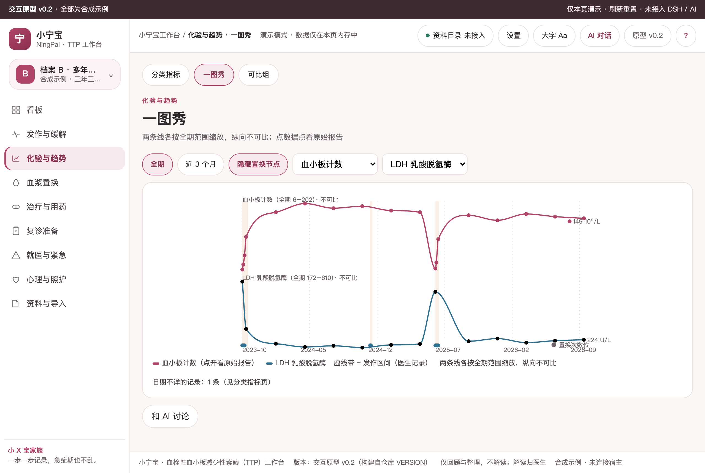
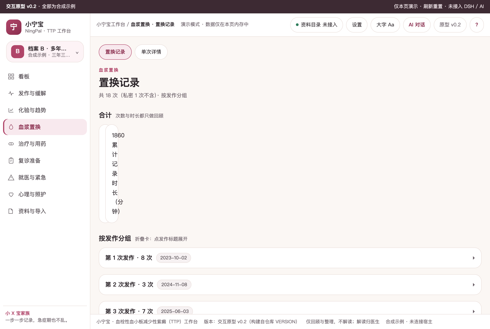
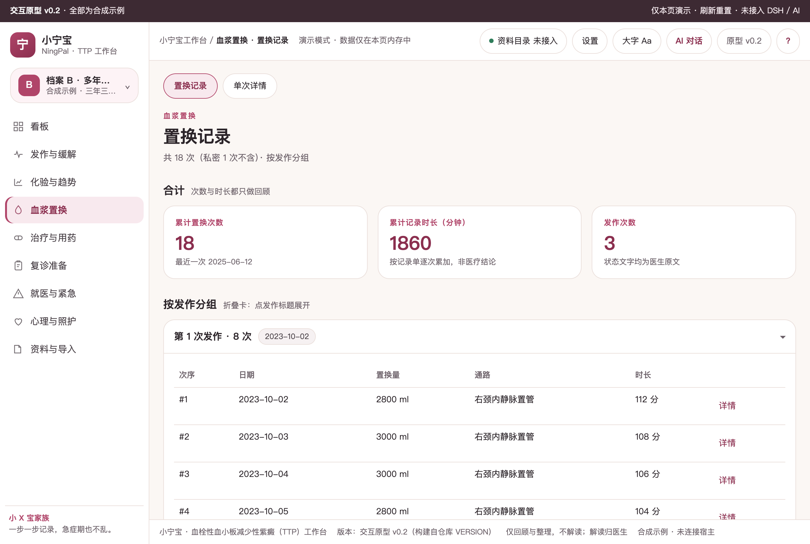
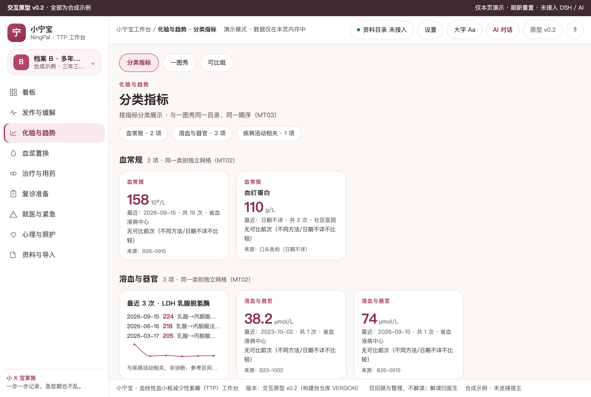
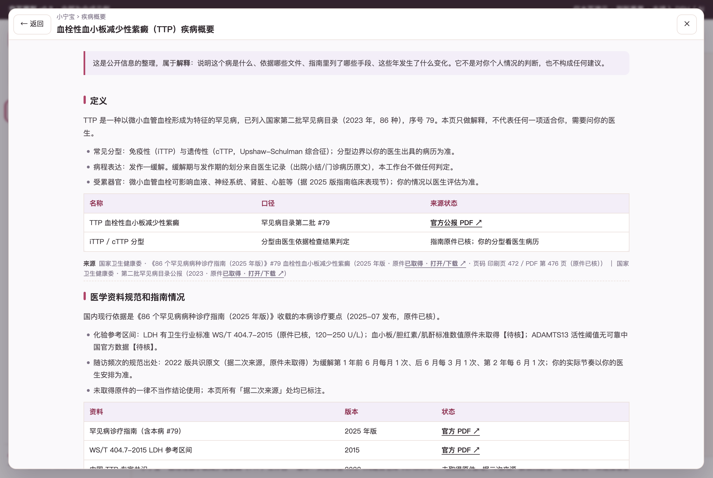
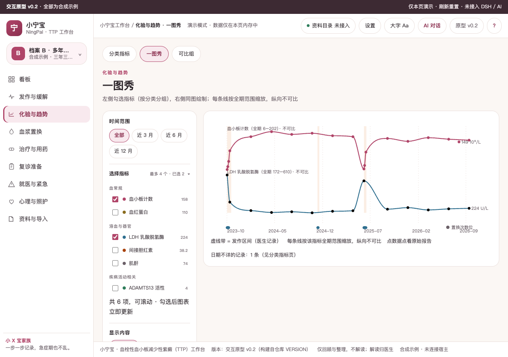
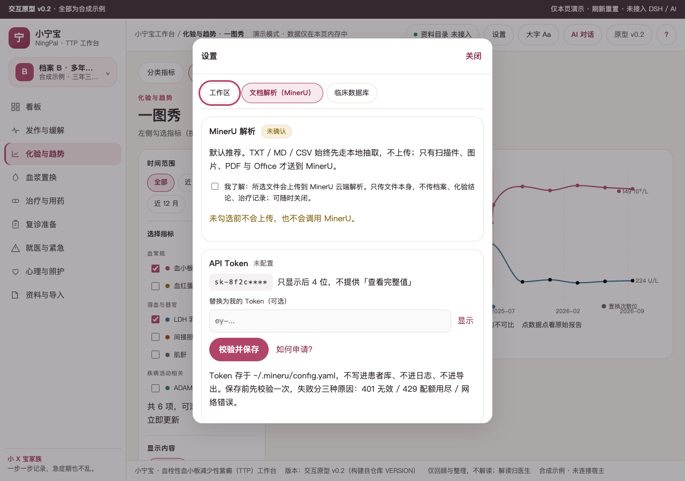
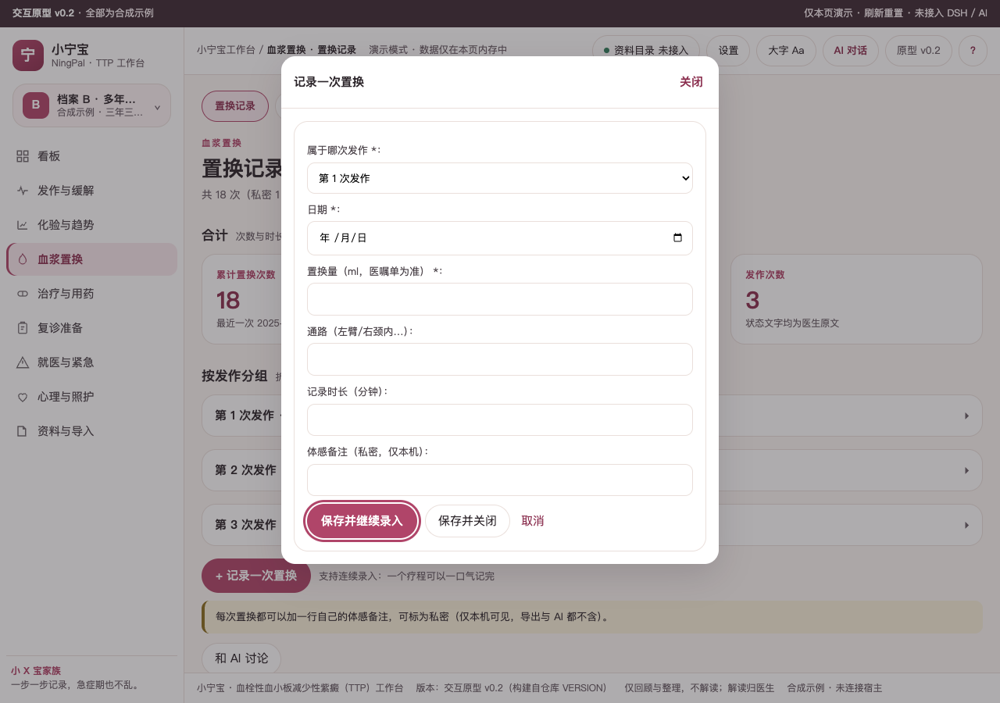
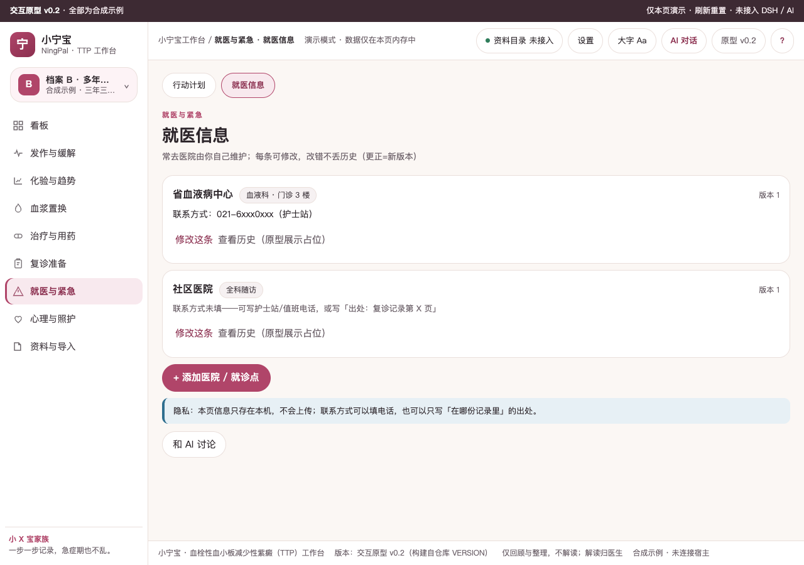

# 小宁宝 · 血栓性血小板减少性紫癜（TTP）工作台

本机优先的血栓性血小板减少性紫癜（TTP）发作—缓解病程资料整理工作台：血浆置换疗程、血小板/LDH/ADAMTS13 化验趋势、缓解期复发监测与复诊准备（品牌名「小宁宝」为占位，待晨审追认）

当前状态：**原型 v0.2 + 可安装开发版 v0.2.8**。原型为 10 个一级页 / 23 条叶子路由的合成数据交互原型（看板、发作与缓解、化验与趋势、血浆置换、治疗与用药、临床试验、复诊准备、就医与紧急、心理与照护、资料与导入）；开发版含 SQLite 数据层、bootstrap 读模型、DSH Desktop 面板外壳与合同检查链。全部为演示数据，不含真实病历；0 患者访谈、0 临床审核，阈值与频次文案均【待核】。需求见 [BRIEF](docs/BRIEF.md)，规格见 [SPEC](docs/SPEC.md)，任务见 [TASKS](docs/TASKS.md)；先读 [AGENTS](AGENTS.md)。

## 开发顺序

先共创SPEC和候选数据关系，再交付HTML交互工作台；由用户确认对应版本/模块后，复核SCHEMA/API并实现生产功能。确认记录见docs/PROTOTYPE-REVIEW.md；模型不依赖前端Tab/流程。模板骨架不是业务已确认。

## 当前能力

- **原型（prototypes/v0.2）**：10 个一级页 / 23 条叶子路由；两套合成档案 A（刚确诊、记录少）/ B（多年随访）可切换；一图秀按分类勾选指标（rail 双栏）；临床试验三子页（档案对照 / 检索 / 收藏与跟踪，本地快照 75 条，登记状态未核实，不做排名与百分数）；六类录入窗口（发作/置换/用药/感受/资料/问题清单）支持「保存并继续录入」；就医信息支持多医院增改与版本号；设置三 tab（工作区 / 文档解析 MinerU / 临床数据库）。
- **开发版（dsh/ + lib/ + public/）**：SQLite 4 迁移、19 表、演示播种（2 档案/51 化验/25 置换/8 用药/7 资料）；`/api/ttp/api/bootstrap` 读模型与原型同形状；customFrame 面板 + 原生会话位 + 1px splitter（25–45% 可拖可收）；`ttp:agent-draft` 草稿只填不发。
- **数据与红线**：判读列 0 命中；私密三出口过滤；禁词检查进链；临床快照 193 条（通道终态照 `source_statuses` 如实展示）。
- **已验证边界**：装机 v0.2.7 已在 DSH Desktop profile 激活并完成 DOM 走查；实机窗口截图待人工补（IAB 截图通道超时）。MinerU 未接入；写入类操作在原型写演示内存，开发版写 API 待办。

## 开发与本地验收

需要 Node.js 22+、Git、包管理器和可用 DSH Desktop；采用 SQLite 时另核验 node:sqlite 版本条件。宿主 peers 的范围仅是模板基线，请与目标 Desktop 实际依赖核对。

```bash
npm install
npm run check
npm run pack:check
npm pack
```

`npm run check` 只保证"能装"（语法 + 装包合同），第一天就该是绿的。`npm run audit` 管"还是不是家族里的一员"：版本三处一致、`lib/layout.js` 面板参数单一来源、检查链完整、文档与密钥卫生，**只看代码与文件，不看文档自述**。新项目刚生成时 audit 必然有 fail，那是待办清单；交付/发布前必须清零，存在 fail 不得发布（`npm run release:check` 一次跑完两者）。

跑的时间点：**每次改完**跑 `check`；**G2 原型确认后、写业务代码前**先跑一次 `audit`（这时缺的多是 `lib/layout.js`、`VERSION` 这类结构，越早补越便宜）；**交付/装机前**必须跑 `release:check`；**发布或投稿前**把 `npm run audit --json` 的 `xx/xx 通过 · N 失败 · M 待人工` 抄进 `docs/RELEASE.md` 的「家族一致性」一行。`✗` 是结构缺口（补齐，或在 `docs/DEV-REQUIREMENTS-<日期>.md` 写明偏离理由并由用户确认），`!` 是需人工判断的项（逐条给「已人工确认 / 确实没有」）。

`npm install` 可能按 npm 策略解析 peer；勿为消警告重复打包宿主 runtime。客户端本身是单文件；引入 TS/组件库后需添加构建步骤并保留单文件导出。

本地安装入口以当前 Desktop/CLI 帮助为准。安装后按 [docs/06-VALIDATION-AND-RELEASE.md](docs/06-VALIDATION-AND-RELEASE.md) 与官方自测完成真实 UI 验收，并填写 [docs/ACCEPTANCE.md](docs/ACCEPTANCE.md)。静态检查不代表已加载。

Logo 来源与使用限制见 assets/README.md。许可证、作者、仓库/发布策略由本项目维护者确认后填写；模板默认为 private/UNLICENSED。

感谢小x宝社区、DataElement 社区，以及 sam / hhx / 繁华的 ❤️ 贡献。

初始化来源记录见 `.dsh-wb-starter.json`。更新社区脚手架不会覆盖本项目；需要升级时先用相同确认配置在临时目录生成，再审阅差异。CLI 用法见 [docs/CLI-GIT.md](docs/CLI-GIT.md)。

## HTML先行与数据演进

业务开发前先交付HTML交互工作台原型、实际预览并由用户确认版本/hash和范围。数据设计先区分领域事实、流程状态和页面读模型，走查前端/流程变化、兼容与迁移；原型对象不直接作为表。见[规范](docs/14-HTML-AND-DATA-CONTRACT.md)。

## 疾病概要

顶栏「?」打开整页《疾病概要》，四段都带来源行与核验状态（原件已核 / 官方入口页 / 未取得原件）。中国口径只认官方来源：国家卫健委《86 个罕见病病种诊疗指南（2025 年版）》#79（印刷页 472，PDF 原件已核）、第二批罕见病目录公报（2023）、WS/T 404.7-2015。本页按受累器官与病情轻重排列相关资料；不代表任何一项适合你，需要问你的医生。

### 定义

TTP 是以微小血管血栓形成为特征的罕见病，国家第二批罕见病目录（2023，86 种）#79；分型（免疫性 iTTP / 遗传性 cTTP）与病程（发作—缓解）以医生病历原文为准，本工作台不做判定。

### 医学资料规范和指南情况

现行依据为《86 个罕见病病种诊疗指南（2025 年版）》#79（原件已核）；LDH 参考区间有行业标准 WS/T 404.7-2015（原件已核，120–250 U/L）；ADAMTS13 活性阈值等无可靠中国官方数据【待核】；随访频次规范出处为 2022 版共识（据二次来源，原件未取得），实际以你的医生安排为准。

### 目前治疗全景概要

只列医生可能提到的方向名词（血浆置换按次、糖皮质激素、免疫抑制治疗、抗 vWF 药物、遗传型以血浆输注为主），按受累器官与病情轻重排列；不代表任何一项适合你，需要问你的医生。紧急口径只按你的医生已确认的行动计划原话执行。

### 发展趋势

只记录已发生事实：血浆置换自上世纪 90 年代起成为基础治疗（据 2025 版指南回顾）；针对 vWF 的药物国内已有企业按优先审评申报（CDE 公示 2025，批准状态未核实）；国际上存在长期登记研究（据二次来源，未取得原件）。

## 关键功能（截图墙）


看板——缓解第 N 天、距上次发作多少天、近 90 天发作次数；紧急行动计划只呈现医生已确认的原话。


一图秀——两条线各按全期范围缩放（纵向不可比）；发作区间为背景带；置换节点单独一层；点数据点看原始报告。

 
血浆置换——按一次发作分组、逐次记录置换量/通路/时长，收展两态。


分类指标卡——正面最近值与「较上次」（仅回顾不解读），翻面看最近几次与可比组说明；194px 定高翻面。


疾病概要整页——四段齐全、每段强制来源行。


刚确诊档案 A——多处空态给下一步按钮；两套合成档案可随时切换对照。


一图秀——左 rail 选时间范围与指标（按分类勾选，最多 4 条），右主图每条线独立条带、不可比。


设置——工作区 / 文档解析（MinerU）/ 临床数据库 三 tab；MinerU 未接入时如实标注。

 
录入窗口——「保存并继续录入」支持一个疗程连录；就医信息支持多医院增改与版本号。

## 怎么用

双击打开 `prototypes/v0.2/index.html`（或任意静态服务器）。顶栏：资料目录 / 设置 / 大字 / AI / 版本 / ?。左栏十个一级页：看板、发作与缓解、化验与趋势、血浆置换、治疗与用药、临床试验、复诊准备、就医与紧急、心理与照护、资料与导入。演示版顶栏 AI 未接通：点「和 AI 讨论」只填草稿，不会发送。

## 数据与口径

- 全部数据为合成示例（`demo-data.js` 是唯一来源），标注「未连接宿主」；不含任何真实病历。
- 临床试验：`trials-data.js` 由 `research/ttp/trials-2026.jsonl` 快照生成（标题相关 75 条，快照 2026-11-04）；登记状态一律「未核实」，不做匹配排名与百分数（非肿瘤无病理/基因结构化字段）。
- 隐私：私密记录在看板摘要预览、导出、AI 上下文三个出口一律排除，页内标注「N 条中私密 M 条」。
- 化验按「指标+方法+机构」分可比组：不同方法不合并、不做差、不连线。
- 无判读列：不诊断、不分级、不做复发判定；阈值与参考区间标【待核】或「以你的医生安排为准」。

## 开发

- 原型 v0.2：`prototypes/v0.2/`（六件，含 trials-data.js）。检查链：`npm run check`（含探针覆盖、禁词、链接断言、底本残留、试验契约断言）。
- 全量走查探针：`node scripts/probe-ttp-m2.mjs`（23 条叶子路由 + 一图秀/指标卡断言，需本机 Chrome）。
- 截图：`node scripts/capture-screens.mjs`（README 用，文件名含版本）。
- 版本唯一来源：仓根 `VERSION`；里程碑状态见 `docs/DEV-PLAN.md`，签认见 `docs/signoffs/`。
